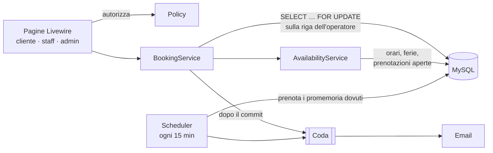

# Studio Booking

[Read in English](README.md)

Un sistema di prenotazioni per uno studio con servizi e operatori (parrucchiere, fisioterapista, palestra con istruttori). Il cliente prenota online un orario libero, lo staff vede la propria agenda, l'admin gestisce listino, orari di lavoro e ferie.

La parte interessante non è il CRUD ma le garanzie che ci stanno dietro: **nessuna doppia prenotazione con richieste simultanee**, **orari corretti anche al cambio dell'ora legale** ed **email inviate esattamente quando devono partire**.

Realizzato con Laravel 13, Livewire 4, Flux UI e Tailwind CSS. PHP 8.4, MySQL o SQLite.

## Cosa può fare ogni ruolo

| Ruolo | Funzioni |
|---|---|
| **Cliente** | Sceglie servizio, operatore e giorno, vede solo gli orari davvero liberi, prenota, riceve l'email di conferma e un promemoria 24 ore prima, annulla gratis fino a 24 ore prima. |
| **Staff** | Vede la propria agenda del giorno e segna gli appuntamenti come completati o "non presentato" quando sono iniziati. |
| **Admin** | Gestisce i servizi (prezzo, durata, attivo), gli operatori (servizi offerti, orari settimanali con pausa pranzo, ferie e chiusure), vede tutte le agende e prenota per conto dei clienti. Se crea un operatore con un'email, nasce un account staff e parte un link per impostare la password. |

## Architettura



- **`AvailabilityService`** calcola gli orari d'inizio liberi di un servizio con un operatore in un giorno. È logica di calendario sopra poche query, ed è la classe testata più a fondo.
- **`BookingService`** gestisce ogni cambio di stato: creazione, annullamento, completamento, no-show. Fa rispettare le regole di business chiunque lo chiami; le policy decidono *chi* può chiamarlo.
- **I componenti Livewire** sono sottili: validano l'input, autorizzano con le policy e trasformano le eccezioni di dominio in messaggi.

## Scelte principali

### Niente doppie prenotazioni

Due clienti che cliccano lo stesso orario nello stesso istante non devono riuscire entrambi. `BookingService::book()` apre una transazione, blocca la riga dell'operatore con `SELECT … FOR UPDATE`, ricontrolla la disponibilità e solo dopo inserisce. Le prenotazioni dello stesso operatore vengono messe in fila; quelle di operatori diversi non si aspettano mai.

Alternative valutate:

- **Vincolo di esclusione PostgreSQL** (`EXCLUDE USING gist` su un intervallo di tempo): la garanzia più elegante, data dal database stesso, ma lega il progetto a PostgreSQL.
- **Tabella di slot con indice univoco**: semplice, ma rigida con servizi di durata diversa (un servizio di 90 minuti occupa più slot).

Il lock è dimostrato con una gara vera, non con un mock: [`DoubleBookingTest`](tests/Feature/Concurrency/DoubleBookingTest.php) avvia due processi PHP che prenotano lo stesso orario su MySQL. Ogni processo rallenta apposta il controllo di disponibilità, così entrambi controllano prima che l'altro inserisca: senza lock il test produce due prenotazioni, con il lock una sola. Un dettaglio che su MySQL conta: il lock è la prima lettura della transazione, quindi lo snapshot di InnoDB nasce *dopo* aver ottenuto il lock e la seconda richiesta vede la prima prenotazione.

### Fusi orari e ora legale

Ogni data è salvata in UTC. Gli orari di lavoro sono ore "da orologio" nel fuso dello studio (`APP_BUSINESS_TIMEZONE`, di default `Europe/Rome`) e vengono convertiti in UTC giorno per giorno. Un turno alle 09:00 corrisponde alle 08:00 UTC d'inverno e alle 07:00 UTC d'estate, e un test fissa proprio la settimana del cambio d'ora.

### Ciclo di vita della prenotazione

`pending → confirmed → completed`, oppure `cancelled` / `no_show`. Le transizioni consentite stanno nell'enum `BookingStatus` (`canTransitionTo()`). Ogni cambio viene scritto in `booking_status_histories` con chi l'ha fatto. I cambi di stato bloccano la riga della prenotazione, quindi due modifiche simultanee non possono passare entrambe il controllo. "Completata" e "non presentato" sono accettati solo dopo l'inizio dell'appuntamento.

### Notifiche inviate una volta sola

- Le email di conferma e di annullamento vanno in coda **dopo il commit della transazione**: una prenotazione annullata da un rollback non invia mai email.
- L'orario del promemoria (`reminder_due_at`) si calcola al momento della prenotazione; chi prenota con meno di un giorno di anticipo non lo riceve.
- Lo scheduler "prenota" ogni promemoria con un `UPDATE … WHERE reminder_sent_at IS NULL` prima di metterlo in coda, quindi esecuzioni sovrapposte non avvisano mai due volte lo stesso cliente. Un promemoria ancora in coda viene scartato se nel frattempo la prenotazione è stata annullata.

### Scelte più piccole

- **Prezzo copiato**: il prezzo viene salvato sulla prenotazione, così cambiare il listino non riscrive lo storico.
- **Disattivare, mai cancellare**: servizi e operatori con prenotazioni si disattivano; le chiavi esterne ne impediscono la cancellazione.
- **Il ruolo non è assegnabile da un form**: una richiesta di registrazione non può renderti admin, e un test lo dimostra.
- **Soldi in centesimi interi**: un prezzo scritto `19,99` viene convertito con l'aritmetica delle stringhe, mai con i numeri decimali.

## Avvio

Requisiti: PHP 8.4, Composer, Node 22.

```bash
composer setup            # installa, crea .env, esegue le migrazioni, compila gli asset (SQLite di default)
php artisan db:seed       # studio demo: servizi, operatori, orari, prenotazioni
composer run dev          # server, worker della coda, log e Vite
```

Apri http://localhost:8000. Tutti gli account demo hanno la password `password`:

| Account | Ruolo |
|---|---|
| `cliente@example.com` | Cliente |
| `giulia@example.com`, `marco@example.com` | Staff |
| `admin@example.com` | Admin |

I promemoria richiedono lo scheduler: `php artisan schedule:work`.

### Con Docker (Laravel Sail: app, MySQL 8.4, Mailpit)

Dopo `composer install` e `cp .env.example .env`, imposta questi valori in `.env` e avvia i container:

```dotenv
DB_CONNECTION=mysql
DB_HOST=mysql
DB_USERNAME=sail
DB_PASSWORD=password
MAIL_MAILER=smtp
MAIL_HOST=mailpit
MAIL_PORT=1025
```

Se sul computer è già attivo un MySQL, la porta 3306 è occupata: aggiungi anche `FORWARD_DB_PORT=3307`.

```bash
./vendor/bin/sail up -d
./vendor/bin/sail artisan key:generate
./vendor/bin/sail artisan migrate --seed
./vendor/bin/sail npm run dev
./vendor/bin/sail artisan queue:work      # in un altro terminale: invia le email
./vendor/bin/sail artisan schedule:work   # in un altro terminale: invia i promemoria
```

L'app gira su http://localhost e Mailpit mostra tutte le email su http://localhost:8025.

## Test

```bash
composer test             # Pint, PHPStan (livello 7) e la suite PHPUnit
```

La suite gira su SQLite in memoria. La gara sulla doppia prenotazione richiede lock veri sulle righe, quindi su SQLite si salta da sola e nella CI gira su MySQL. Per lanciarla in locale:

```bash
# con Sail
./vendor/bin/sail exec -e DB_CONNECTION=mysql -e DB_DATABASE=testing laravel.test php artisan test --group=concurrency

# con un MySQL locale e un database vuoto
DB_CONNECTION=mysql DB_DATABASE=studio_booking_test DB_USERNAME=root DB_PASSWORD=secret php artisan test --group=concurrency
```

GitHub Actions esegue due job a ogni push: lint, analisi statica e test su SQLite, e l'intera suite su MySQL 8.4, gara compresa.

## Struttura del progetto

```
app/
├── Enums/            BookingStatus (ciclo di vita), UserRole, Weekday
├── Services/         AvailabilityService, BookingService
├── Livewire/         Bookings/ (cliente), Staff/Agenda, Admin/
├── Policies/         BookingPolicy, OperatorPolicy, ServicePolicy
├── Notifications/    BookingConfirmed, BookingCancelled, BookingReminder
├── Console/Commands/ SendBookingReminders
└── Exceptions/       errori di dominio mostrati all'utente
tests/
├── Feature/          servizi, pagine, policy, comandi, notifiche
└── Concurrency/      lo script che la gara sulla doppia prenotazione esegue in due processi
```

## Limiti noti e prossimi passi

- Lo stato `pending` è riservato a pagamenti online o approvazione manuale; oggi le prenotazioni vengono confermate subito.
- L'admin sceglie il cliente da un elenco semplice; oltre qualche centinaio di clienti serve un campo di ricerca.
- Non sono supportati orari di lavoro che iniziano nell'ora saltata dal cambio d'ora primaverile (02:00–03:00); uno studio non li ha mai.
- Idee: lista d'attesa, statistiche per l'admin, esportazione CSV, link iCal per l'agenda dello staff.
