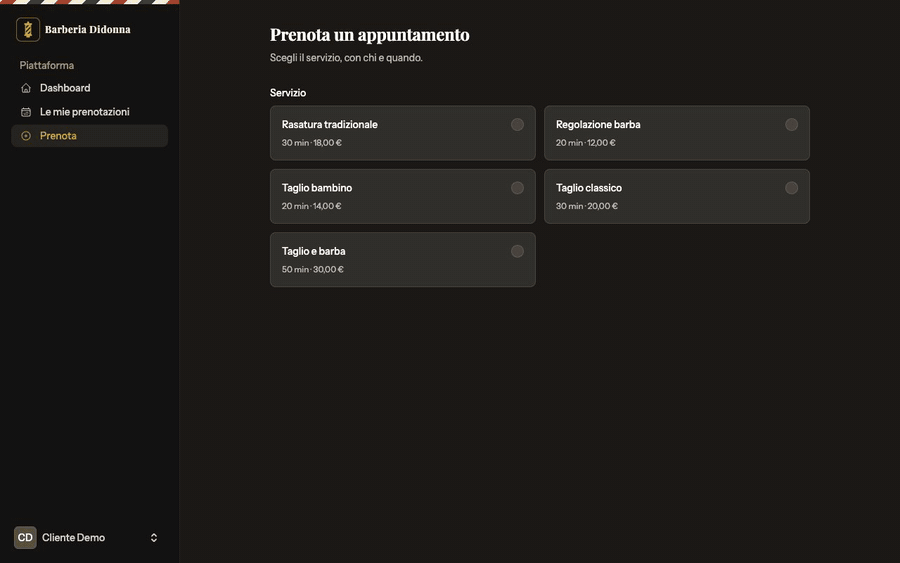
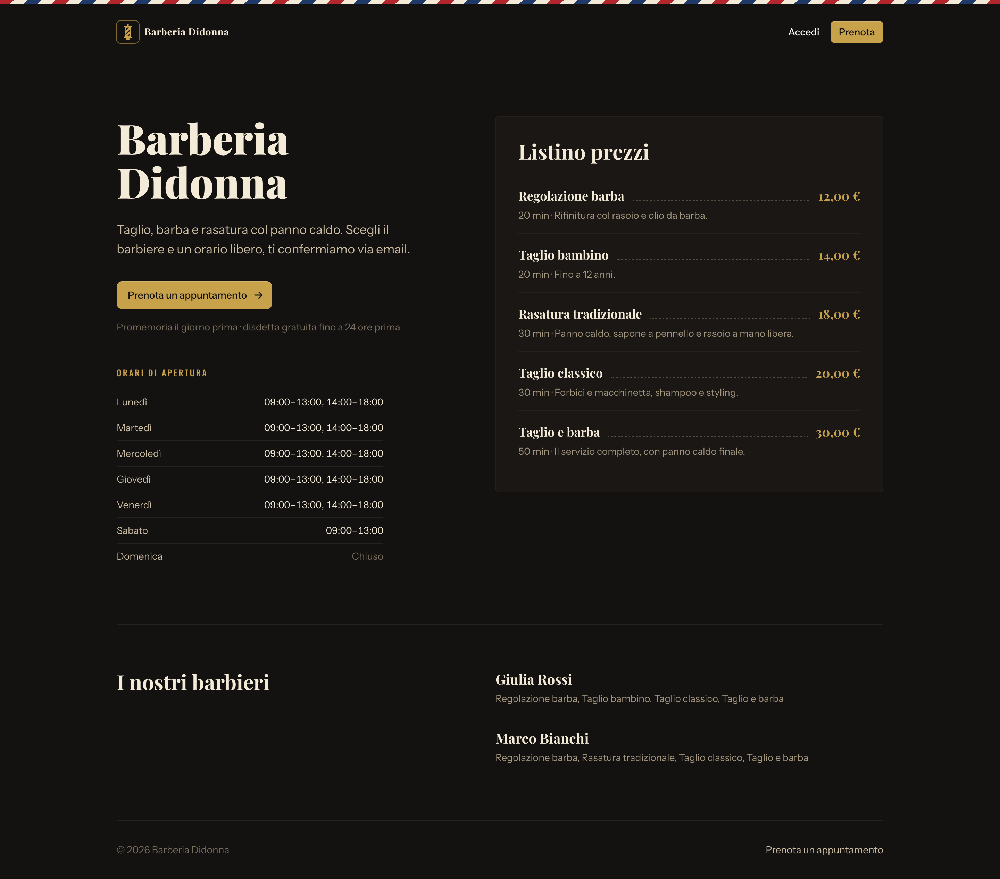
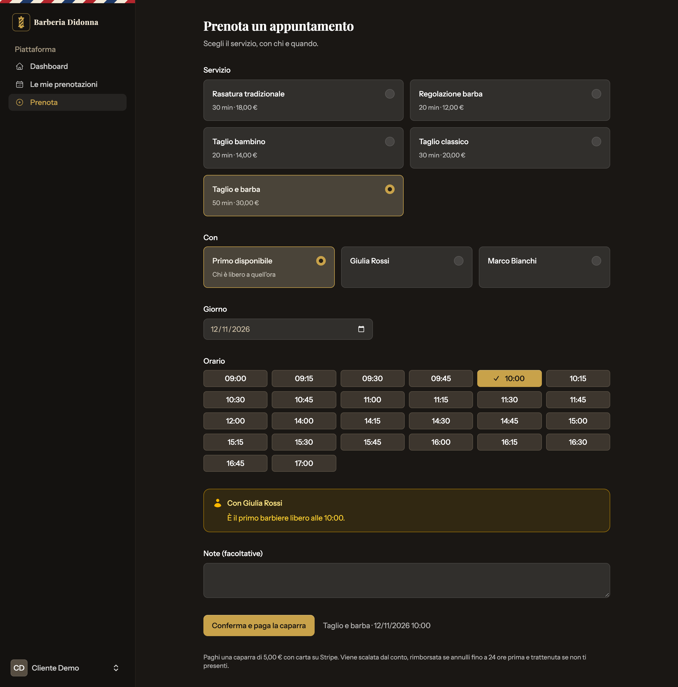
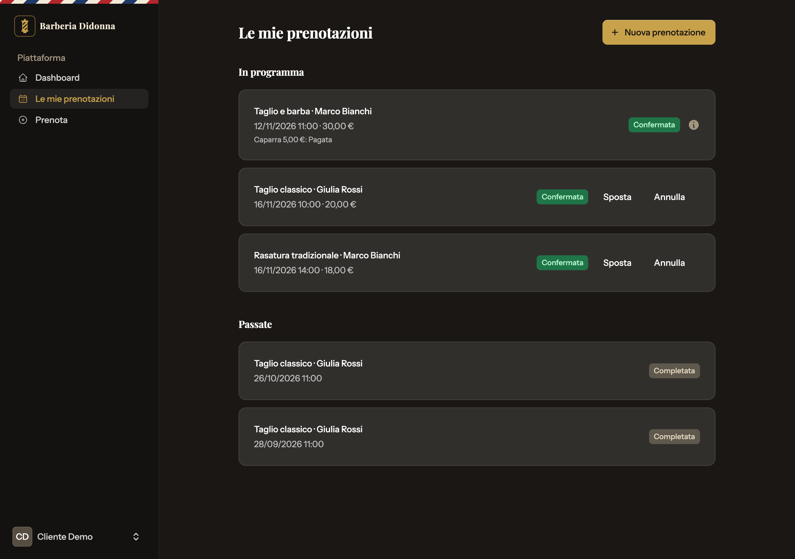
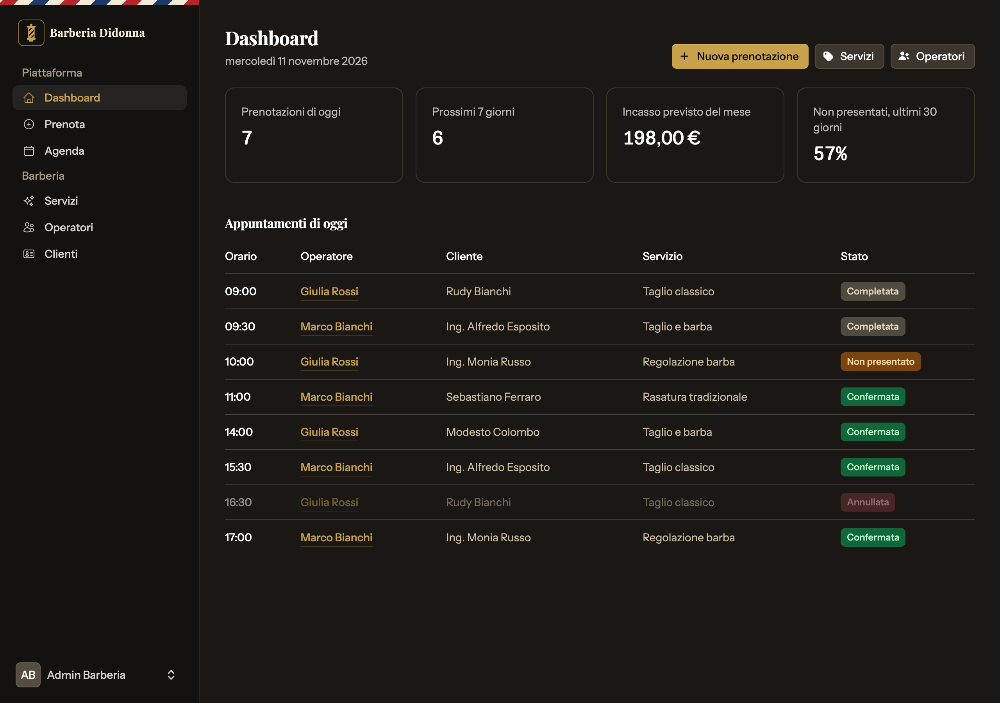
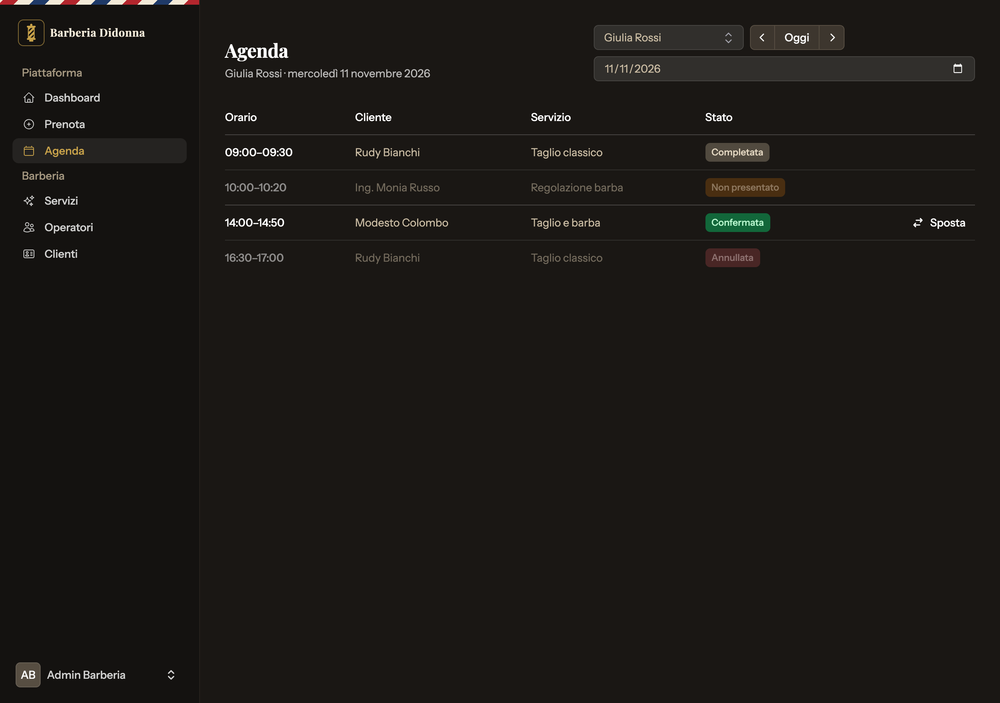
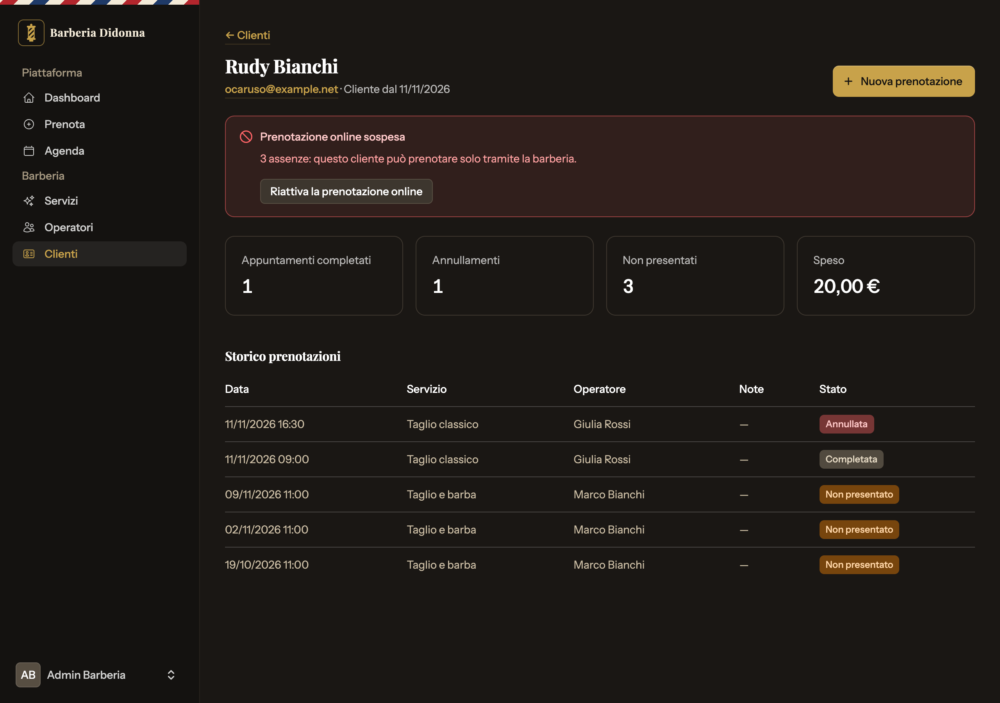
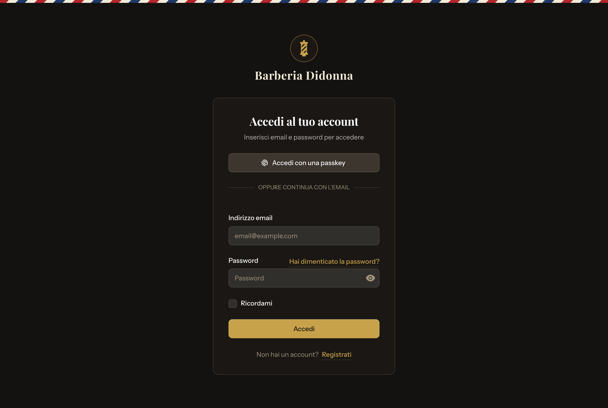
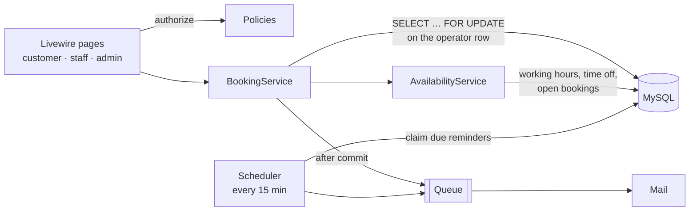

# Barberia Didonna

[](https://github.com/DarioDidonna/barbershop-booking/actions/workflows/tests.yml)

[Leggi in italiano](README.it.md)

A booking system for a barbershop, with a classic barbershop look. Customers book a free time online with the barber they prefer, barbers see their agenda, and the admin manages the price list, the working hours and the holidays. The domain is generic (services and operators), so it fits any appointment-based business.

The interesting part is not the CRUD but the guarantees behind it: **no double bookings under concurrent requests**, **deposits confirmed only by signed Stripe webhooks**, **correct times across daylight saving changes**, and **emails that are sent exactly when they should be**.

Built with Laravel 13, Livewire 4, Flux UI, Tailwind CSS and Stripe Checkout. PHP 8.4, MySQL or SQLite.

## Screenshots

A customer books with "first available barber": the page says who they will get before they confirm and pay the 5 € deposit ([video](docs/screenshots/booking-flow.mp4)).



| | |
|---|---|
|  **Home**: price list first, opening hours computed from the barbers' shifts |  **Booking**: free times only, and who "first available" assigns |
|  **My bookings**: move or cancel within 24 hours, deposit status |  **Admin dashboard**: today's appointments and key figures |
|  **Agenda**: a barber's day, completed and no-show once started |  **Customer record**: history, spending, no-show block |

<details>
<summary>Mobile and login</summary>

 

</details>

## What each role can do

| Role | Features |
|---|---|
| **Customer** | Picks a service and a barber, or the first available one, sees only the times that are really free and books. Gets a confirmation email with a calendar event (.ics) and a reminder 24 hours before. Moves or cancels for free up to 24 hours before. |
| **Staff** | Sees their own daily agenda and marks appointments as completed or no-show once they have started. |
| **Admin** | Manages services (price, duration, active), operators (services offered, weekly hours with lunch breaks, holidays and closures), sees every agenda, books and moves bookings on behalf of customers. Adding time off cancels the bookings it covers and emails their customers. Customer records show history, spending and no-shows. Creating an operator with an email creates a staff account and sends a link to set the password. |

## Architecture



- **`AvailabilityService`** computes the free start times of a service with an operator on a day. It is pure scheduling logic on top of a few queries, which makes it the most thoroughly tested class.
- **`BookingService`** owns every state change: creating, cancelling, completing, no-show. It enforces the business invariants whoever calls it; policies decide *who* may call it.
- **Livewire components** are thin: they validate input, authorize with the policies and turn domain exceptions into messages.

## Key decisions

### Preventing double bookings

Two customers clicking the same time at the same moment must not both succeed. `BookingService::book()` opens a transaction, locks the operator row with `SELECT … FOR UPDATE`, re-checks availability and only then inserts. Concurrent bookings for the same operator are serialized; bookings for different operators never wait for each other.

Alternatives considered:

- **PostgreSQL exclusion constraint** (`EXCLUDE USING gist` on a time range): the most elegant guarantee, enforced by the database itself, but it ties the project to PostgreSQL.
- **A slot table with a unique index**: simple, but rigid when services have different durations (a 90-minute service spans several slots).

The lock is proven by a real race, not a mock: [`DoubleBookingTest`](tests/Feature/Concurrency/DoubleBookingTest.php) starts two PHP processes that book the same time against MySQL. Each process deliberately slows down the availability check, so both check before either inserts: without the lock the test produces two bookings, with it exactly one. A detail that matters on MySQL: the lock is the first read of the transaction, so the InnoDB snapshot is taken *after* the lock is acquired and the second request sees the first booking.

### Time zones and daylight saving time

Every timestamp is stored in UTC. Working hours are wall-clock times in the business timezone (`APP_BUSINESS_TIMEZONE`, default `Europe/Rome`) and are converted to UTC day by day. A 09:00 shift is 08:00 UTC in winter and 07:00 UTC in summer, and a test pins the week the clocks change.

### Booking lifecycle

`pending → confirmed → completed`, or `cancelled` / `no_show`. The allowed transitions live in the `BookingStatus` enum (`canTransitionTo()`). Every change is written to `booking_status_histories` with who made it. Status changes lock the booking row, so two concurrent changes cannot both pass the check. Completed and no-show are only accepted once the appointment has started.

### Notifications that are sent once

- Confirmation and cancellation emails are queued **after the transaction commits**: a rolled-back booking never sends an email.
- The reminder time (`reminder_due_at`) is computed when the booking is made; bookings made less than a day ahead get none.
- The scheduler claims each reminder with a conditional `UPDATE … WHERE reminder_sent_at IS NULL` before queueing it, so overlapping runs never remind a customer twice. A reminder still waiting in the queue is dropped if the booking is cancelled in the meantime.

### Deposits with Stripe

A customer booking online pays a 5 € deposit through Stripe Checkout. It is taken off the bill, refunded if the customer cancels in time or the barbershop cancels, and kept after a no-show. Admins booking at the desk take no deposit, and without Stripe keys deposits are off entirely.

- **Pending holds the slot.** The booking is created as `pending` inside the same locked transaction as any other booking, so the slot cannot be sold twice while the customer is paying. The hold lasts 30 minutes, the shortest expiry Stripe Checkout allows.
- **Only the webhook confirms.** The redirect back from Checkout can be faked by anyone; a signed `checkout.session.completed` event cannot. The booking is confirmed, and its email sent, only from the webhook.
- **Every event is handled once.** The event id is stored in `stripe_webhook_events` in the same transaction that acts on it: a repeated delivery is ignored, and a failure rolls both back so Stripe's retry is handled.
- **Released if unpaid.** `checkout.session.expired` frees the slot; a scheduled command does the same if that event never arrives. A payment that arrives after the slot was released is refunded automatically.
- **Refunds are queued and idempotent.** A job retries with backoff, and its Stripe idempotency key is tied to the booking, so a retry never refunds twice. The card data never touches the app: Checkout is hosted by Stripe.

### Smaller choices

- **Price snapshot**: the price is copied onto the booking, so changing the catalogue never rewrites history.
- **Deactivate, never delete**: services and operators with bookings are deactivated; foreign keys forbid deleting them.
- **Roles are not mass-assignable**: a registration request cannot make itself admin, and a test proves it.
- **Money as integer cents**: prices typed as `19,99` are converted with string arithmetic, never through floats.
- **Fair use of the agenda**: a customer holds at most 3 upcoming bookings, up to 60 days ahead. After 3 no-shows online booking pauses until an admin enables it again; admins booking at the desk are not limited.
- **Moving keeps the calendar in sync**: the .ics event keeps the booking's UID and raises its SEQUENCE, so the customer's calendar moves the appointment instead of duplicating it.

## Getting started

Requirements: PHP 8.4, Composer, Node 22.

```bash
composer setup            # install, create .env, migrate, build assets (SQLite by default)
php artisan db:seed       # demo barbershop: services, barbers, hours, bookings
composer run dev          # server, queue worker, logs and Vite
```

Open http://localhost:8000. Every demo account uses the password `password`:

| Account | Role |
|---|---|
| `cliente@example.com` | Customer |
| `giulia@example.com`, `marco@example.com` | Staff |
| `admin@example.com` | Admin |

Reminders need the scheduler: `php artisan schedule:work`.

To try the deposit, put your Stripe **test** keys in `.env` and forward the webhooks with the [Stripe CLI](https://docs.stripe.com/stripe-cli):

```bash
stripe listen --api-key "$(grep '^STRIPE_SECRET=' .env | cut -d= -f2)" --events checkout.session.completed,checkout.session.expired,checkout.session.async_payment_succeeded,checkout.session.async_payment_failed --forward-to localhost:8000/stripe/webhook   # prints the whsec_… secret
```

`--api-key` makes the CLI listen to the same Stripe account as the key in `.env`; without it, the CLI listens to whichever account `stripe login` chose, and the events never arrive.

```dotenv
STRIPE_SECRET=sk_test_…
STRIPE_WEBHOOK_SECRET=whsec_…
```

Pay with the test card `4242 4242 4242 4242`, any future date and any CVC.

### With Docker (Laravel Sail: app, MySQL 8.4, Mailpit)

After `composer install` and `cp .env.example .env`, set these values in `.env` and start the containers:

```dotenv
DB_CONNECTION=mysql
DB_HOST=mysql
DB_USERNAME=sail
DB_PASSWORD=password
MAIL_MAILER=smtp
MAIL_HOST=mailpit
MAIL_PORT=1025
```

If MySQL already runs on your machine, port 3306 is taken: also add `FORWARD_DB_PORT=3307`.

```bash
./vendor/bin/sail up -d
./vendor/bin/sail artisan key:generate
./vendor/bin/sail artisan migrate --seed
./vendor/bin/sail npm run dev
./vendor/bin/sail artisan queue:work      # in another terminal: sends the emails
./vendor/bin/sail artisan schedule:work   # in another terminal: sends the reminders
```

The app runs on http://localhost and Mailpit shows every email on http://localhost:8025.

## Tests

```bash
composer test             # Pint, PHPStan (level 7) and the PHPUnit suite
```

The suite runs on in-memory SQLite. The double-booking race needs real row locks, so it skips itself on SQLite and runs in CI against MySQL. To run it locally:

```bash
# with Sail
./vendor/bin/sail exec -e DB_CONNECTION=mysql -e DB_DATABASE=testing laravel.test php artisan test --group=concurrency

# with a local MySQL and an empty database
DB_CONNECTION=mysql DB_DATABASE=studio_booking_test DB_USERNAME=root DB_PASSWORD=secret php artisan test --group=concurrency
```

GitHub Actions runs two jobs on every push: lint, static analysis and tests on SQLite, and the full suite on MySQL 8.4, race included.

## Project structure

```
app/
├── Enums/            BookingStatus (lifecycle), UserRole, Weekday
├── Services/         AvailabilityService, BookingService
├── Livewire/         Bookings/ (customer), Staff/Agenda, Admin/
├── Policies/         BookingPolicy, OperatorPolicy, ServicePolicy
├── Notifications/    BookingConfirmed, BookingCancelled, BookingReminder
├── Console/Commands/ SendBookingReminders
└── Exceptions/       domain errors shown to the user
tests/
├── Feature/          services, pages, policies, commands, notifications
└── Concurrency/      the script the double-booking race runs in two processes
```

## Known limitations and next steps

- The admin picks the customer from a plain list; a searchable field is needed beyond a few hundred customers.
- Working hours that start inside the hour skipped by the spring clock change (02:00–03:00) are not supported; a studio never has them.
- Ideas: waiting list, statistics for the admin, CSV export, iCal links for the staff agenda.
